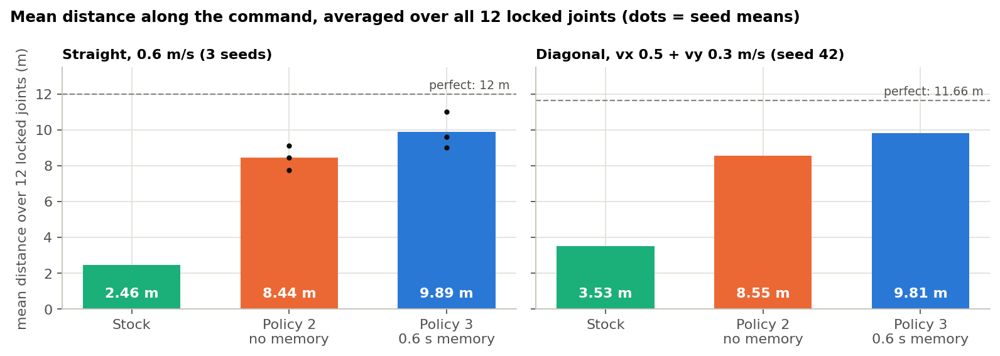
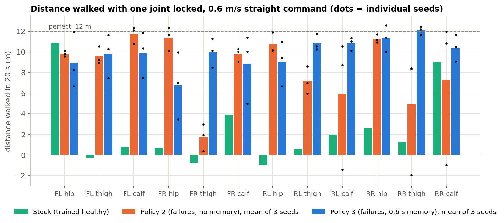

# Fault-Tolerant Quadruped Locomotion under Actuator Failure

A Unitree Go2 trained in Isaac Lab to keep walking when one of its 12 joints locks solid. The project compares three PPO policies to answer one question: does the robot need short-term memory to cope with a locked joint, or is a single snapshot of its own state enough?

<!-- VIDEO: drag media/compare_FR_thigh_3way.mp4 onto this line in the GitHub editor -->

Front-right thigh locked, 0.6 m/s forward command. From left to right: the stock policy, policy 2 (failures, no memory) and policy 3 (failures, 0.6 s of memory).

## The question

A locked joint is hard to detect from one instant of sensor data. A knee reading 40° is a normal value on its own, and it only becomes evidence of a fault when the policy can see that the knee has stayed at 40° while it has been commanding it to move. That comparison needs history. Every close piece of prior work (listed at the bottom) gives its policy a history window and none of them tests whether the history is what makes it work. This project runs that comparison directly, with the history window as the only difference between the two failure-trained policies.

| Policy | Trained on | Observation |
|---|---|---|
| 1, stock | healthy robot only (Isaac Lab's Go2 flat-terrain policy) | current state |
| 2, no memory | one random joint locked, 20% healthy episodes | current state (48 values) |
| 3, memory | same as policy 2 | last 30 steps of state, 0.6 s at 50 Hz (30 × 48 values) |

Policies 2 and 3 use the same reward, the same 128-128-128 MLP, the same PPO settings and 2,048 parallel robots, and both are trained from scratch for 2,000 iterations on seeds 42, 43 and 44. Neither is ever told which joint failed, so any fault identification has to come from proprioception. Policy 3 could not start from the stock weights because its input is 30 times larger, so policy 2 also starts from scratch to keep initialisation out of the comparison.

## How the failure works

The lock is applied in physics. At every episode reset, `lock_one_joint` in `mdp/events.py` picks one of the 12 joints and narrows its position limits to its current angle ± 0.001 rad, so the joint becomes rigid regardless of what the actuator commands. Overriding the action instead would not have worked, because the Go2 actuator is a PD model with kp = 25 and a held target only produces a stiff spring that flexes under load.

Isaac Lab clamps `default_joint_pos` into the new limits when they are written, and the joint-position observation is measured relative to that default. Left alone, the locked joint would read a constant 0 and hand the policy the answer. The event restores the nominal defaults after every write to close that leak.

## Results

Each test runs 256 robots for 20 s with a fixed command, pushes and observation noise turned off, and one joint locked for the whole run. The score is the distance walked along the command, so a perfect run covers 12 m at 0.6 m/s. Reward is not used as a metric because it is shaped differently for each training condition.



| Straight, 0.6 m/s | Stock | Policy 2 | Policy 3 |
|---|---|---|---|
| Mean distance over 12 joints | 2.46 m | 8.44 ± 0.67 m | 9.89 ± 1.03 m |
| Seed means (42 / 43 / 44) | 2.46 | 7.76 / 8.45 / 9.11 | 9.02 / 9.61 / 11.02 |
| Worst joint, any seed | −0.97 m (RL hip) | −1.94 m (RR thigh) | 3.44 m (FR hip) |
| Joint–seed cases reaching ≥ 10 m | 1 / 12 | 19 / 36 | 23 / 36 |
| Joint–seed cases under 3 m | 9 / 12 | 6 / 36 | 0 / 36 |
| Healthy robot | 12.30 m | 11.90 / 12.12 / 10.59 | 11.88 / 12.10 / 12.14 |

Policy 3 walks 82% of the commanded distance on average, against 70% for policy 2 and 20% for the stock policy. The mean gain from memory is 1.45 m, and with three seeds per policy a Welch t-test on the seed means gives p ≈ 0.12, so the mean difference alone is not statistically conclusive. The worst case is where the difference is clearest: every policy 2 seed has at least one joint where the robot stalls or walks backwards, while policy 3 never drops below 3.4 m on any joint or seed. Memory also costs nothing on a healthy robot, since policy 3 stays within 0.42 m of the stock policy when nothing is broken. The only falls in the whole sweep are policy 3 seed 43 with the FR calf locked, where 49% of robots fall after 5.6 s on average.



The per-joint chart shows where memory helps. Averaged over seeds, policy 3 gains the most on the thigh joints (FR thigh +8.2 m, RR thigh +7.2 m) and on the RL calf (+4.9 m). It pays for those gains at the FR hip (−4.6 m on all three seeds) and gives up smaller amounts at the FL calf and RL hip. Policy 2 can only learn one gait for every fault, and the thigh joints are where that compromise gait fails, which is consistent with policy 3 using its history to tell those faults apart.

<!-- VIDEO: drag media/fleet_policy3_s44_random_locks.mp4 onto this line -->

Policy 3 (seed 44) with 25 robots, each with a different random joint locked.

### Diagonal command

The straight test only asks for forward motion, so the sweep was repeated with a diagonal command of vx 0.5 m/s and vy 0.3 m/s (a perfect run covers 11.66 m along a 31° line). No retraining was needed because all policies were trained on commands in [−1, 1] m/s on both axes. This sweep covers seed 42 only.

| Diagonal, seed 42 | Stock | Policy 2 | Policy 3 |
|---|---|---|---|
| Mean distance along the command | 3.53 m | 8.55 m | 9.81 m |
| Worst joint | −2.12 m (FL hip) | 1.83 m (RR thigh) | 3.64 m (FL hip) |
| Joints under 3 m | 7 / 12 | 2 / 12 | 0 / 12 |
| Healthy robot | 11.60 m | 7.55 m | 12.05 m |

The ranking holds and policy 3 again has no joint under 3 m. Policy 2 seed 42 cannot follow the diagonal even with no joint locked: it travels at 75° instead of 31° and ends 7.4 m off the line.

<!-- VIDEO: drag media/progress_policy3_FR_thigh_montage.mp4 onto this line -->

Policy 3 with the FR thigh locked at training iterations 0, 250, 500, 1000 and 1999.

## Repository layout

```
source/fault_tolerant_go2/.../fault_tolerant_go2/
  mdp/events.py                    lock_one_joint: the failure model
  fault_tolerant_go2_env_cfg.py    train and play configs for policies 2 and 3
  agents/rsl_rl_ppo_cfg.py         PPO runner configs
scripts/rsl_rl/
  train.py, play.py                Isaac Lab's rsl_rl scripts
  eval_distance.py                 distance and fall evaluation, writes results/<label>.json
scripts/make_readme_charts.py      builds the charts in docs/img from results/
results/                           130 evaluation files (straight sweep, 3 seeds; diagonal sweep, seed 42)
training_curves/                   every logged training value per iteration, as CSV, for all 7 runs
docs/runs.md                       training run log
```

## Running it

Tested with Isaac Sim 5.1.0, Isaac Lab 2.3.2, Python 3.11 and PyTorch 2.7.0 (CUDA 12.8) on Ubuntu 24.04 with an RTX 3070 Ti Laptop GPU (8 GB). Install Isaac Lab first, then install this package into the same environment:

```bash
pip install -e source/fault_tolerant_go2
```

| Task | Use |
|---|---|
| `FT-Go2-Flat-Locked-v0` | train policy 2 |
| `FT-Go2-Flat-Locked-Hist30-v0` | train policy 3 |
| `FT-Go2-Flat-Locked-Play-v0` | watch or evaluate policy 2 or the stock policy |
| `FT-Go2-Flat-Locked-Hist30-Play-v0` | watch or evaluate policy 3 |

Train:

```bash
python scripts/rsl_rl/train.py --task FT-Go2-Flat-Locked-Hist30-v0 \
  --headless --num_envs 2048 --max_iterations 2000 --seed 43
```

One run takes 22–29 minutes per 2,000 iterations on the laptop above for seeds 43 and 44.

Evaluate one locked joint (add `--healthy` for no lock, `--vx 0.5 --vy 0.3` for the diagonal command):

```bash
python scripts/rsl_rl/eval_distance.py --headless \
  --task FT-Go2-Flat-Locked-Hist30-Play-v0 \
  --checkpoint logs/rsl_rl/ft_go2_flat_locked_hist30/<run>/model_1999.pt \
  --joint FR_thigh_joint --label policy3_FR_thigh
```

Watch it:

```bash
python scripts/rsl_rl/play.py --task FT-Go2-Flat-Locked-Hist30-Play-v0 --num_envs 16 \
  --checkpoint logs/rsl_rl/ft_go2_flat_locked_hist30/<run>/model_1999.pt \
  'env.events.lock_joint.params.joint_names=[FR_thigh_joint]'
```

## Limitations

- Three seeds per policy are enough to show the worst-case difference but not enough for the mean difference to reach significance (p ≈ 0.12).
- The diagonal sweep uses seed 42 only.
- The evaluation config sets the yaw-rate command range to (0, 0). Isaac Lab clips its heading controller's output to that range, so heading is not actively held during evaluation and some robots turn while walking. This affects all three policies in the same way, and it contributes to the sideways drift in the diagonal test.
- Each test locks the joint from the first step. Failure partway through a stride, limp (zero-torque) joints, and two simultaneous failures are not tested.
- Flat terrain only, in simulation only.

## Prior work

- Saving the Limping: Fault-tolerant Quadruped Locomotion via Reinforcement Learning, arXiv:2210.00474 (A1, locked joints, 50-step history through a 1D CNN)
- Learning Quadrupedal Locomotion with Impaired Joints Using Random Joint Masking, arXiv:2403.00398 (Go1, locked and zero-torque joints, 30-step history)
- DreamFLEX, arXiv:2502.05817 (Go1, locked and weakened joints, history-based fault estimator)
- Learning Fault-Tolerant Locomotion with Adaptive Gait Timing, arXiv:2608.07328 (torque and power loss, compares history length 1 and 3)

All of the locked-joint papers above give the policy a history window. This project measures what that window contributes by training the same policy with and without it on the same robot, failure model and evaluation.

## Authors

Anshul Paliwal and Avanish Chandan Jagu, VIT Chennai. Built on the [Isaac Lab](https://github.com/isaac-sim/IsaacLab) external project template.
